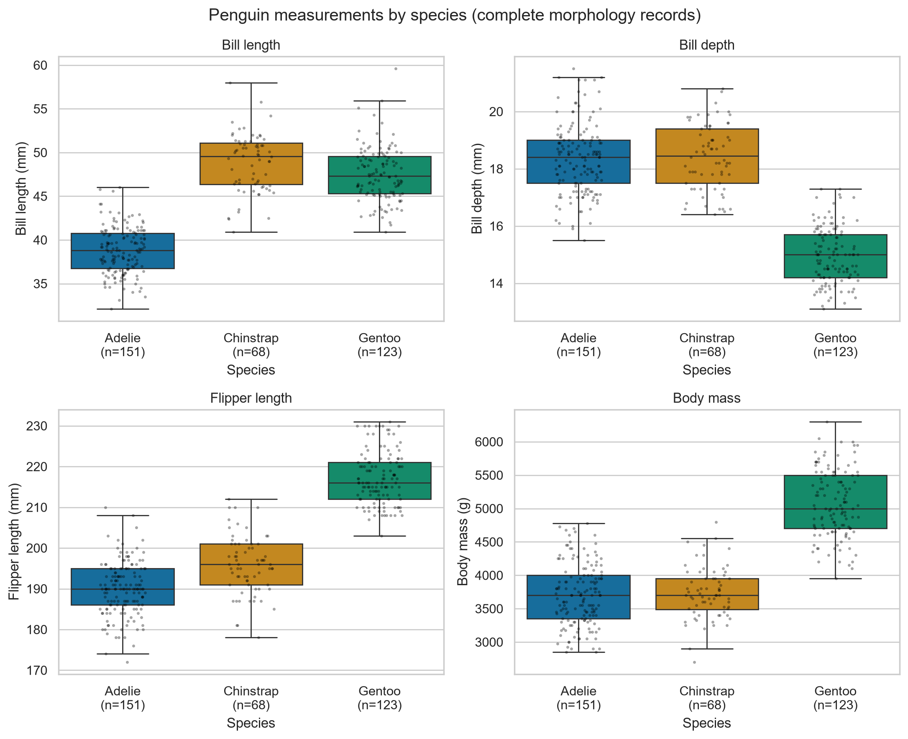
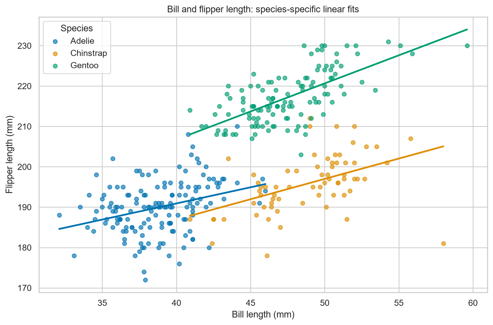

# Penguin Morphometrics: Can Four Measurements Identify a Species?

This project compares four morphological measurements in Palmer Penguins and achieves 1.000 test accuracy on one fixed species-classification split, while documenting overlap and limits to generalization.

## Problem

How do Adelie, Chinstrap, and Gentoo differ in bill length, bill depth, flipper length, and body mass? Which measurements show the strongest descriptive separation, and how accurately can those four measurements identify species on held-out observations?

Morphological measurements help ecologists describe variation in body size and shape. Here, distributions and within-species associations distinguish variation among individuals from differences between species; they cannot explain the biological causes of those differences.

A simple scaled logistic classifier makes a transparent teaching example with reproducible preprocessing and evaluation. Look for overlapping distributions in Figure 1, species-specific trends in Figure 2, and test errors in Figure 3.

## Data source and permissions

- **Dataset:** Palmer Penguins, collected by Kristen Gorman and Palmer Station LTER during 2007–2009 on three islands in the Palmer Archipelago, Antarctica.
- **Sources:** [CSV](https://raw.githubusercontent.com/allisonhorst/palmerpenguins/main/inst/extdata/penguins.csv) and [official documentation](https://allisonhorst.github.io/palmerpenguins/).
- **Downloaded:** 2026-10-21 (Asia/Shanghai); offline copy: [data/penguins.csv](data/penguins.csv). Provenance: [data/SOURCE.txt](data/SOURCE.txt).
- **Permissions:** CC0 1.0 permits redistribution. The official page also provides LTER use guidance and asks prospective publishers to contact the data collector about collaboration.
- **Citation:** Horst AM, Hill AP, Gorman KB (2020). *palmerpenguins: Palmer Archipelago (Antarctica) penguin data*. R package version 0.1.0. [doi:10.5281/zenodo.3960218](https://doi.org/10.5281/zenodo.3960218).
- This simplified animal dataset contains no personal or sensitive information. Code is MIT licensed; figures are generated from these data.

| Item | Observed value |
|---|---|
| Rows | 344 |
| Columns | 8 |
| Raw species counts | Adelie 152; Chinstrap 68; Gentoo 124 |
| Missing counts | bill_length_mm 2; bill_depth_mm 2; flipper_length_mm 2; body_mass_g 2; sex 11 |
| Columns without missing values | species, island, year |

## Methods

The script validates the exact eight-column schema, converts the four measurements to numeric, and removes rows missing species or any measurement. Two rows are removed, leaving 342 observations (Adelie 151, Chinstrap 68, Gentoo 123); no mean imputation is used. Raw missing counts are reported before conversion.

Exploratory analysis uses complete morphology records for species counts, means, medians, and sample standard deviations. Pairwise-complete Pearson correlations and sample sizes are computed overall and within each species for bill length versus flipper length, and flipper length versus body mass. CSV statistics are rounded to three decimals. Descriptive eta-squared is calculated on 342 complete-case observations as between-species sum of squares divided by total sum of squares; it ranks observed separation without measuring predictive feature importance or statistical significance.

The four measurement features feed a StandardScaler + LogisticRegression(max_iter=2000) pipeline. A stratified 75/25 split with random_state=42 produces 256 training and 86 test observations. Five-fold StratifiedKFold cross-validation (shuffle=True, random_state=42) uses training data only; reported SD uses ddof=0. Each fold fits its own scaler through the pipeline. Accuracy, macro F1, per-class precision/recall/F1, and a confusion matrix evaluate the held-out predictions.

There is no fitting of the scaler or classifier on the test set, no test-based tuning or feature selection, and no island, sex, or year features. Exploratory plots describe the full sample; the specified model was fixed before evaluation.

Validated software: Python 3.12.0; pandas 2.3.3; NumPy 2.5.4; Matplotlib 3.11.2; seaborn 0.13.2; scikit-learn 1.9.1. Compatible dependency ranges are in requirements.txt; future compatible versions may produce small numerical differences.

## Findings

1. **Descriptive separation:** Gentoo mean body mass is 5076.016 g, versus 3700.662 g for Adelie and 3733.088 g for Chinstrap; mean bill depth is 14.982 mm versus 18.346 and 18.421 mm. Flipper length has the highest descriptive eta-squared (0.778), followed by bill length (0.708), bill depth (0.680), and body mass (0.670). [Figure 1](figures/01_measurements_by_species.png).
2. **Overlap remains:** Adelie and Chinstrap mean bill lengths are 38.791 and 48.834 mm, but their median masses are both 3700.000 g and their bill-depth medians are 18.400 and 18.450 mm; individual distributions overlap. Gentoo mean flipper length is 217.187 mm versus 189.954 and 195.824 mm, with some boundary overlap. [Figure 1](figures/01_measurements_by_species.png), [Figure 2](figures/02_bill_vs_flipper.png).
3. **Predictive performance:** Test accuracy and macro F1 are both 1.000 across 86 observations; the diagonal counts are 38 Adelie, 17 Chinstrap, and 31 Gentoo, with zero errors, so this split has no dominant confusion pair. Training-only CV accuracy is 0.980 ± 0.012, showing that perfect test performance is not guaranteed across splits. [Figure 3](figures/03_confusion_matrix.png).
4. **Pooled associations need context:** Flipper length versus mass has overall r=0.871, exceeding within-species r=0.468 (Adelie), 0.642 (Chinstrap), and 0.703 (Gentoo); bill versus flipper length has overall r=0.656 versus within-species r=0.326 (Adelie), 0.472 (Chinstrap), and 0.661 (Gentoo), so Gentoo is an exception to a universal pooled-greater-than-within claim. The pattern is consistent with species differences contributing to pooled association, without establishing causation. [Figure 2](figures/02_bill_vs_flipper.png), [correlation results](results/correlations.csv).

## Limitations

- Sampling covers only three species, three islands, and 2007–2009; results cannot be generalized to all penguins or later years.
- There are only 344 raw rows and 342 complete modeling records. Chinstrap has 68 raw rows, creating class imbalance.
- These observational data cannot establish causation or isolate environmental, sex, or age effects.
- Two rows lack all four measurements; sex has 11 missing values. Sex is excluded from the main model; complete-case exclusion could introduce bias.
- Measurement error and rounding may affect associations; species labels are assumed correct.
- A single holdout split varies with sampling. Training-only five-fold CV partially addresses variability, but there is no external validation set or grouping by sampling site/year.
- High accuracy does not imply biological importance. Classification demonstrates distinguishability, not why species differ.
- Figures are descriptive and cannot support conservation or policy recommendations.
- The eta-squared ranking uses 342 complete-case observations and correlated measurements; it is not a ranking of independent model contributions.

## How to run

Requires Python 3.10+ and Git. Replace YOUR-USERNAME with the human owner's GitHub username after publication; the repository has not yet been published. Installation needs internet, but subsequent analysis reads only the committed CSV.

Windows PowerShell:

~~~powershell
git clone https://github.com/YOUR-USERNAME/data-science-project.git
cd data-science-project
python -m venv .venv
.\.venv\Scripts\Activate.ps1
python -m pip install -r requirements.txt
python src/analysis.py
python -m py_compile src/analysis.py
~~~

If execution policy blocks activation, use the environment directly:

~~~powershell
.\.venv\Scripts\python.exe -m pip install -r requirements.txt
.\.venv\Scripts\python.exe src/analysis.py
~~~

macOS/Linux:

~~~bash
git clone https://github.com/YOUR-USERNAME/data-science-project.git
cd data-science-project
python3 -m venv .venv
source .venv/bin/activate
python -m pip install -r requirements.txt
python src/analysis.py
python -m py_compile src/analysis.py
~~~

The script rewrites three PNG figures and three result files listed below. Analysis took 0.867 seconds in the initial validation run (excluding installation/startup); typical runs should take under 30 seconds, depending on hardware. It can run from another directory by passing the script's path.

Troubleshooting: install missing packages with the same Python interpreter used to run the script. If the CSV is missing, restore data/penguins.csv from this repository; paths resolve relative to the script, not the current directory. Matplotlib explicitly uses Agg, so no GUI backend or display is required.

## Project structure

~~~text
data-science-project/
├── README.md                             # Research question, methods, findings, and reproduction
├── LICENSE                               # MIT license for code
├── requirements.txt                      # Compatible dependency ranges
├── .gitignore                            # Local environment and cache exclusions
├── data/
│   ├── penguins.csv                      # Original offline dataset
│   └── SOURCE.txt                        # Source, download date, license, and checksum
├── src/
│   └── analysis.py                       # Reproducible analysis entry point
├── figures/
│   ├── 01_measurements_by_species.png     # Four distribution panels
│   ├── 02_bill_vs_flipper.png             # Scatter and species-specific fitted lines
│   └── 03_confusion_matrix.png            # Held-out prediction counts
└── results/
    ├── summary_by_species.csv            # Complete-case counts and descriptive statistics
    ├── correlations.csv                  # Overall and within-species Pearson correlations
    └── metrics.txt                       # Data audit, model evaluation, separation, versions
~~~

## AI assistance

An external AI assistant (<MODEL NAME>; replace before publication) generated the initial code and documentation and executed the reported validation in the project workspace. The human author selected the topic, reviewed the code and README, independently reran the analysis on 2026-10-21, and confirmed that the reported outputs reproduced exactly. The human author retains responsibility for publication and final decisions.

## License and citation

Code: MIT, copyright 2026 <YOUR NAME> (replace before publication). Data: CC0 1.0. Figures were generated from the CC0 data by the included analysis.

Data citation: Horst AM, Hill AP, Gorman KB (2020). *palmerpenguins: Palmer Archipelago (Antarctica) penguin data*. R package version 0.1.0. [https://doi.org/10.5281/zenodo.3960218](https://doi.org/10.5281/zenodo.3960218).

To cite this project after publication, use: <YOUR NAME> (2026). *Penguin Morphometrics: Can Four Measurements Identify a Species?* GitHub repository, data-science-project, <PUBLISHED REPOSITORY URL>, accessed <ACCESS DATE>; include the commit SHA used. These placeholders await the human author's publication details.
